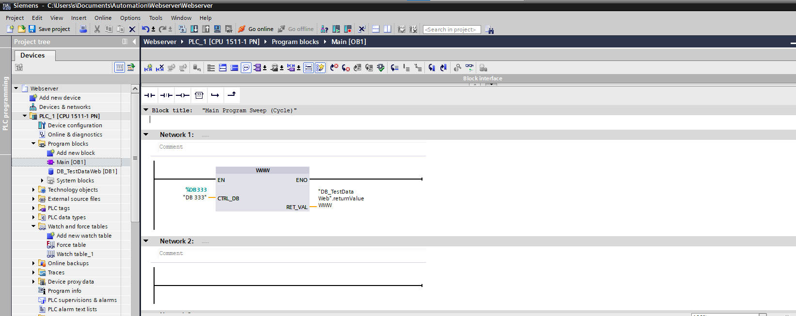
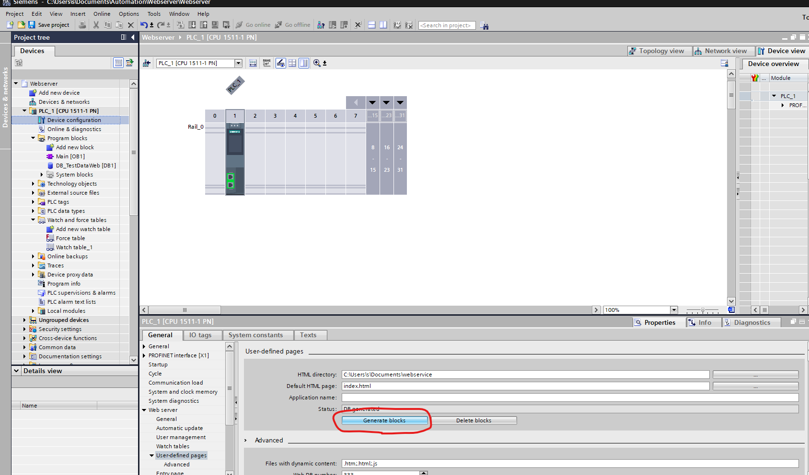
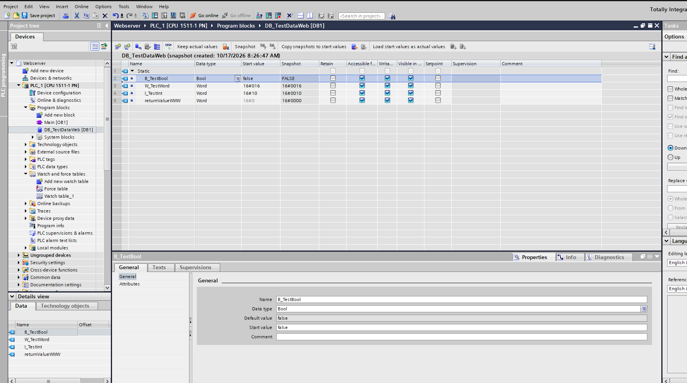
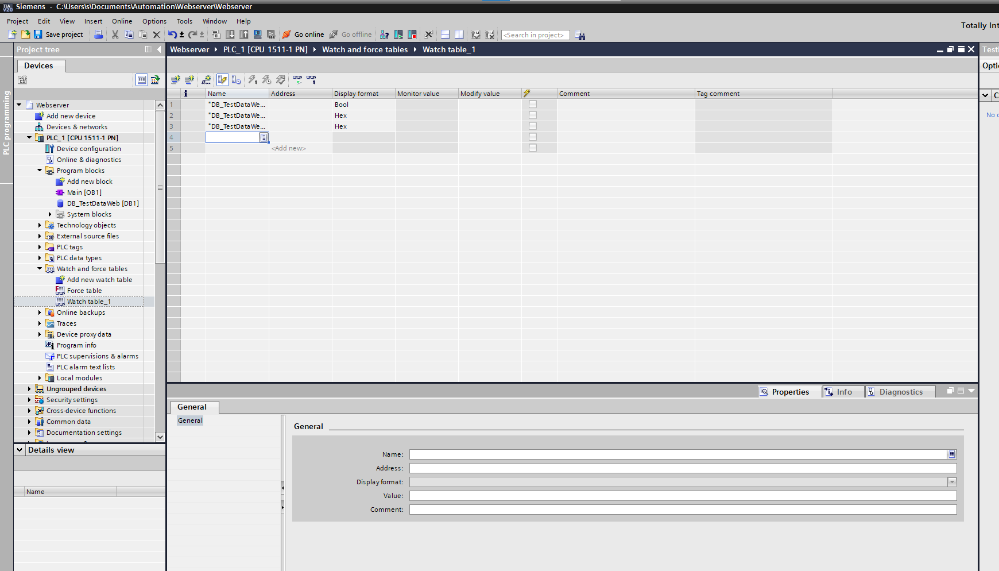
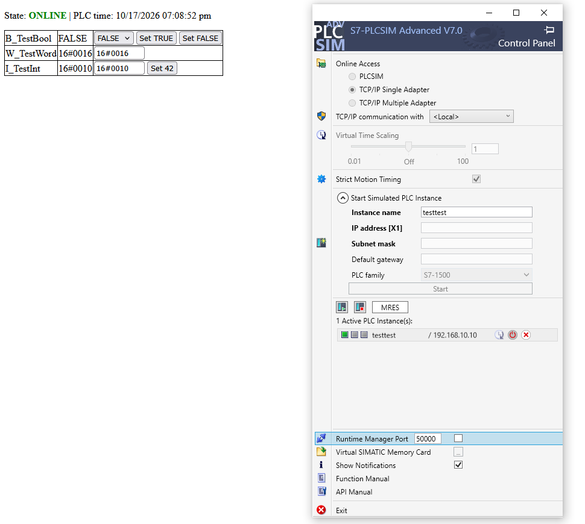
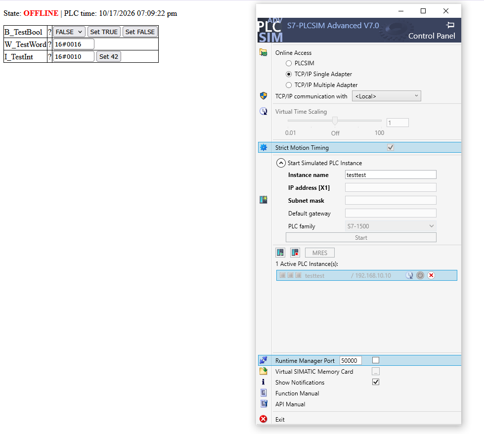

# PLC Web Control

A single-file HTML/JavaScript library to read and write variables of a Siemens S7-1500 (or ET 200MP) PLC through its built-in web server. You write plain HTML with `data-plc-*` attributes, and the script shows the values, writes changes back, and reports the live PLC time and online state.

No HTML element is needed to hold the data. The script loads the PLC's **Watch tables** page in a hidden iframe, reads the values from it, and uses the page's own "Modify value" form to write.

## Features

- Reads every variable found in the PLC watch table and creates one `PlcVariable` object per variable
- Simple HTML bindings: output, input, select, checkbox and buttons, with no JavaScript needed
- Live PLC time, read from the PLC page
- Online/offline detection, based on whether the PLC clock keeps changing
- Automatic refresh (default every 3 s)
- Boolean and 16-bit hex/decimal value formatting
- Plain JavaScript API for your own code

## Requirements

- A PLC (or PLCSim) with the **web server enabled** and a **watch table** configured and visible on the *Watch tables* page
- The HTML file must be served from the **same origin** as the PLC web server (same protocol, host and port). Otherwise the browser blocks access to the iframe content. Typical ways to do this are uploading the file as a user-defined page on the PLC or serving it through a reverse proxy.
- A user with write permission for the watch table, if you want to write values
- A modern browser (uses `class`, `async/await`, `Promise`)

## Quick start

1. In TIA Portal, open the PLC's **Web server > User-defined pages** settings.
2. Set **HMI directory** to the absolute path of this repository's `webservice` folder, for example `C:\Users\YourName\Documents\webservice`. This must be the folder that contains `index.html` and `control.html`, not the repository root.
3. Set **Default HTML page** to `index.html`, then generate the web server blocks.
4. Open the page in the browser from the PLC's web server.
5. Edit `webservice/index.html` to bind your own variables:

```html
<p>
    State: <span data-plc-online></span> |
    PLC time: <span data-plc-time></span>
</p>

<span data-plc-out="B_TestBool"></span>
<input data-plc-in="W_TestWord">
<button data-plc-set="I_TestInt" data-value="42">Set 42</button>
```

The script block at the bottom of the file starts everything:

```js
PlcBind.parse();
PlcWeb.onUpdate(() => PlcBind.refresh());
PlcWeb.init(3000);   // refresh every 3000 ms
```

### TIA Portal setup

Follow these steps to connect the user-defined page to the PLC.

#### 1. Initialize the web server

Make sure the web server is initialized with the `WWW` block in the main program:



#### 2. Select the webservice folder

In the PLC's **Web server > User-defined pages** settings, select the absolute path to the `webservice` folder. This is the folder that contains `index.html` and `control.html`. Then generate the web server blocks.



#### 3. Compile data block changes

After changing the data block, run a **Software compile** so the updated variables become available in the watch table.




#### 4. Check the connection

The page reports the PLC connection state and shows the live PLC time. These examples show the expected online and offline states:





## HTML bindings

| Attribute | Element | Behavior |
|---|---|---|
| `data-plc-out="Name"` | any element | Shows the current value. Shows `?` while offline. |
| `data-plc-in="Name"` | `input`, `select`, checkbox | Shows the current value and writes on `change`. A field with focus is not overwritten while you type. |
| `data-plc-set="Name" data-value="x"` | `button` | Writes the fixed value `x` when clicked. |
| `data-plc-time` | any element | Shows the PLC clock as text, for example `10/17/2026 07:01:23 pm`. |
| `data-plc-online` | any element | Shows `ONLINE` or `OFFLINE` and sets `data-online="true"` or `"false"` for CSS. Optional: `data-text-on` and `data-text-off` change the text. |

**Names:** `Name` can be the short name (`B_TestBool`) or the full name (`DB_TestDataWeb.B_TestBool`). Quotes are removed automatically, so the PLC name `"DB_TestDataWeb".B_TestBool` becomes `DB_TestDataWeb.B_TestBool`. Use the full name if two tables contain the same short name.

**Select options:** for boolean variables use `TRUE` / `FALSE` (or `1` / `0`) as option values.

**Styling the state:**

```css
[data-online="true"]  { color: green; font-weight: bold; }
[data-online="false"] { color: red;   font-weight: bold; }
```

**Dynamic HTML:** if you add bound elements with JavaScript later, call `PlcBind.parse()` again. Elements that are already bound are skipped.

## JavaScript API

The code has three parts: `PlcWeb` (connection, state, list of variables), `PlcVariable` (one variable), and `PlcBind` (the HTML parser).

### `PlcWeb`

| Member | Description |
|---|---|
| `init(refreshMs = 3000)` | Creates the hidden iframe, loads the page once and starts the periodic refresh. Pass `0` to disable the timer. |
| `reload()` | Reloads the iframe, reads the time, and updates all variables. Returns a Promise. |
| `list()` | Returns an array of `{ name, fullName, value }` for all variables and prints it with `console.table`. |
| `get(name)` | Returns the `PlcVariable` for a full or short name, or `null`. |
| `vars` | Object of all variables, keyed by full name. |
| `online` | `true` while the PLC is considered online. |
| `time` | `Date` object of the PLC clock, or `null`. |
| `timeText` | Raw clock text, for example `10/17/2026 07:01:23 pm`. |
| `onUpdate(fn)` | Calls `fn()` after every reload. |
| `onOnline(fn)` | Calls `fn(online)` only when the online state changes. |
| `busy` | `true` while a write is running. The periodic refresh is paused. |

Settings you can change before `init()`:

| Setting | Default | Meaning |
|---|---|---|
| `url` | `/Portal/Portal.mwsl?PriNav=Vartables` | URL of the watch table page |
| `offlineAfterMs` | `10000` | PLC time frozen for this long means offline |
| `loadTimeoutMs` | `5000` | Page not loaded in this time means offline |

### `PlcVariable`

| Member | Description |
|---|---|
| `fullName`, `name` | Full name (`DB_TestDataWeb.B_TestBool`) and short name (`B_TestBool`). |
| `value` | Last value read, as text (`TRUE`, `16#0010`, ...). |
| `update()` | Reads the value from the iframe as it is now. No network request. |
| `await reload()` | Reloads the iframe from the PLC first, then updates this variable. |
| `await write(value)` | Writes a value, waits 1.2 s, reloads, and returns the new value. Throws if the PLC is offline, the value is invalid, or the row is not found. |

```js
PlcWeb.list();                                       // list all variables
PlcWeb.get("DB_TestDataWeb.B_TestBool").update();    // read from loaded iframe
await PlcWeb.get("B_TestBool").reload();             // reload from PLC, then read
await PlcWeb.get("B_TestBool").write(true);
await PlcWeb.get("W_TestWord").write("16#00FF");
await PlcWeb.get("I_TestInt").write(42);
```

### `PlcBind`

| Member | Description |
|---|---|
| `parse(root = document)` | Finds all `data-plc-*` elements and attaches the events. |
| `refresh()` | Pushes the current values, time and state into the HTML. Called automatically after each reload. |
| `write(name, value)` | Writes a value by name and logs errors to the console. |

## How it works

1. `PlcWeb.init()` creates a hidden iframe pointing at the watch table page.
2. After each load, `readTime()` reads `#date` and `#time` from the page. If the text changed since the last reload, the PLC is alive and `lastChange` is updated.
3. While the PLC is online, `scan()` finds every table row that contains a `val_t…` cell, creates a `PlcVariable` for new ones, and `updateAll()` copies the values.
4. `PlcBind.refresh()` writes the values into your HTML.
5. To write, `PlcVariable.write()` fills the text field in the variable's row inside the iframe, clicks **Apply**, waits 1.2 s, and reloads.

## Online state

The PLC is **online** while its clock keeps changing between reloads. It becomes **offline** when:

- the clock text has not changed for `offlineAfterMs` (10 s),
- the `#date` or `#time` element is missing (error page, login page, wrong URL), or
- the page does not load within `loadTimeoutMs` (5 s).

With a 3 s refresh and a 10 s limit, a short network hiccup does not flip the state, and a stopped PLC is detected within about 10 to 13 s. While offline, outputs show `?`, inputs are not overwritten, and `write()` throws an error.

The date parser accepts `m/d/y`, `d.m.y` and `y-m-d`, with 12 h (`am/pm`) or 24 h time, because the format depends on the language selected on the PLC page.

## Value formats

The value is written in the format that matches the current value shown in the watch table:

- **Boolean** (`TRUE` / `FALSE`): accepts `true`, `false`, `1`, `0`, `"TRUE"`, `"FALSE"`
- **Hex** (`16#XXXX`): accepts decimal (`42`) or hex (`16#002A`). The value is normalized to 4 uppercase hex digits and must be between 0 and 65535.
- **Other formats**: sent as plain text

The display format (Bool, Hex, DEC, ...) is chosen in the watch table on the PLC. This library does not change it.

## Project structure

```
.
├── pics/        # screenshots used in this documentation
├── webservice/
│   ├── control.html
│   └── index.html   # the HTML, PlcWeb, PlcVariable and PlcBind in one file
└── README.md
```

## Troubleshooting

| Problem | Likely cause |
|---|---|
| Always `OFFLINE` | The page is not on the same origin as the PLC, the URL is wrong, you are not logged in, or the web server is not reachable. Check the browser console. |
| Values show `?` | The variable is not in the selected watch table, or the name does not match. Run `PlcWeb.list()` to see the names that were found. |
| `row ... not found` on write | The iframe is still loading, or the variable is no longer in the table. |
| Write has no effect | The user has no write permission, or the PLC program overwrites the value. |
| Strange characters at the top of the page | The file header is damaged, for example by an upload or encoding problem. Re-save as UTF-8 without BOM and upload again. |

## Limitations

- Only the variables of the **currently selected watch table** are available. The script does not switch tables.
- It depends on the HTML structure of the Siemens watch table page (`val_t…` cells, the **Apply** form). A firmware change of that page may require adjustments.
- Writes are done one at a time, and each write pauses the refresh for about 1.2 s plus the reload time.
- Hex formatting assumes 16-bit values (0 to 65535).
- This is not a replacement for a safe industrial HMI. Do not use it for safety-relevant functions.

## License

Add your license here, for example MIT.
